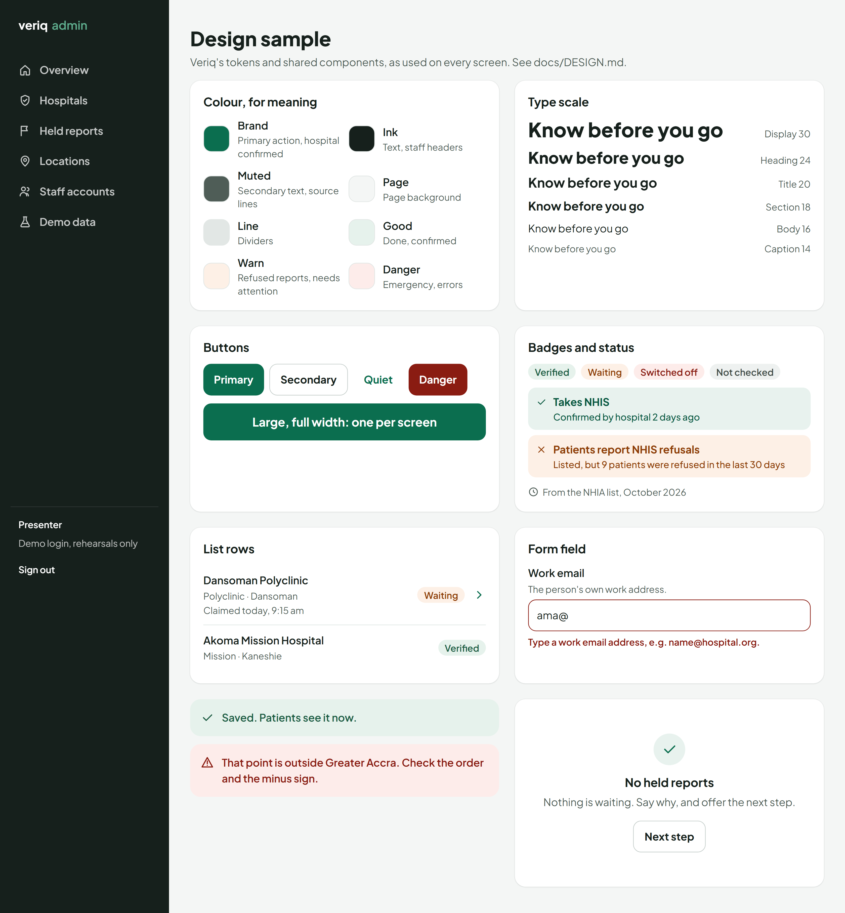

# Veriq design system

Prompt 10. One set of tokens and a few shared components for the patient side and the staff side.

**The goal:** real, professional, minimal. Calm and confident, never busy. One clear action per screen. Rules 4, 7 and 9 always win over looks:

- every fact keeps its source and time;
- touch targets stay at least 44 px;
- words stay plain.

The sample above is a live page: sign in as an admin and open `/admin/design`. Every token and component on it is the real one.

## Tokens (`app/globals.css`)

### Colour: for meaning, not decoration

| Role | Token (Tailwind class) | Value | Use |
| --- | --- | --- | --- |
| Brand | `brand`, `brand-strong`, `brand-soft` | #0B6E4F, #08573F, #E8F2EE | Primary action, "hospital confirmed", selected state |
| Ink | `ink` | #16201C | Text; dark staff headers |
| Muted | `muted` | #4F5D57 | Secondary text and source lines (5.9:1 on white) |
| Surface / page | `surface`, `page` | #FFFFFF, #F4F6F5 | Cards on the page |
| Lines | `line`, `line-strong` | #E2E7E5, #C9D1CE | Dividers; control borders |
| Good | `good-bg`, `good-ink` | #E6F2EC, #1D5C43 | Done, saved, verified |
| Warn | `warn-bg`, `warn-ink` | #FDF0E6, #8F3D07 | Refused reports (B1), waiting, needs attention |
| Danger | `danger-bg`, `danger-ink` | #FDECEA, #8A1C12 | Emergency, errors, switching an account off |
| Neutral | `neutral-bg`, `neutral-ink` | #EEF1F0, #3F4B46 | Not checked (B4), unknown |

The section 2 colours (`brand`, `ink`, `page`, `emergency`, `refused`, `patient`) keep their names. Every tone is a pale background with dark text, and each pair passes WCAG AA. Colour never carries meaning alone: there is always a word and usually an icon.

### Type: Plus Jakarta Sans, one scale, used by role

| Role | Class | Size | Used for |
| --- | --- | --- | --- |
| Display | `text-3xl font-extrabold` | 30 | One screen title (patient and staff headers) |
| Heading | `text-2xl font-extrabold` | 24 | Admin page titles at 390 px; result counts |
| Title | `text-xl font-bold` | 20 | Questions ("What do you need?"), dialog titles |
| Section | `text-lg font-bold` | 18 | Card headings, hospital names |
| Body | `text-base` | 16 | Everything else. Inputs are never smaller (no zoom on phones) |
| Caption | `text-sm text-muted` | 14 | Source lines, hints, meta |

`text-xs` is kept for the SAMPLE DATA tag only. Use no other sizes.

### Spacing, radius, shadow, motion

- **Spacing:** 4 px steps (Tailwind's). Use 16 px side gutters on phones; 24 to 32 px on a laptop. Cards use 16 px padding, 20 px from `sm`. There are 12 to 16 px between cards, and 24 px between sections.
- **Radius:**
  - `--radius-control` (12 px): buttons, inputs, tiles.
  - `--radius-card` (16 px): cards and dialogs.
  - `rounded-full`: chips and badges.
- **Shadow:**
  - `shadow-card`: a hairline plus a 1 px soft shadow, for anything on the page.
  - `shadow-raised`: dialogs, the emergency call buttons, and hover on links shaped like cards.
- **Motion:**
  - `animate-enter`: 240 ms fade-up, used for result cards (staggered 40 ms, at most 6), toasts, dialogs, and the welcome points.
  - `animate-fade`: 160 ms, for the map preview.
  - `prefers-reduced-motion: reduce` turns every animation and transition off (in `globals.css`).

## Components (`components/ui/`)

| Component | What it is for |
| --- | --- |
| `Button` / `buttonClass` | The one button. Variants: primary, secondary, quiet, danger. Sizes: md (48 px) and lg (56 px). With `href` it is a link. Use one primary per screen. |
| `Card` | A white card with an optional heading and something on the right. One idea per card. Tones: plain, warn, danger. |
| `ListRow` | A row with a title, detail, a source line, and a trailing badge, plus a chevron when it opens a page. 56 px or taller. |
| `Badge` | A state in words: Verified, Waiting, Switched off, Held. |
| `BadgeLine` (`components/badges`) | The rule B answer: answer first, then who said so and when. |
| `StatusLine` (`components/facility`) | The rule F status of one service, with its age. |
| `SourceLine` | Rule 4 under a list or fact: where it comes from and when. |
| `EmptyState` | Nothing to show: says so, says why, and offers the next step. |
| `Toast` | The answer to what you just did. Good news is `role=status`; errors are `role=alert`. |
| `ConfirmAction` (`Dialog.tsx`) | A button that asks first, in a native `<dialog>`. It can ask why (for the admin log) and shows a one-time password once. |
| `Field` + `inputClass` | Label, hint and an error tied to the control (`aria-describedby`, `aria-invalid`). |
| `LoadingCards` | Grey blocks while a page loads on 3G. No facts. |

Admin frame (`components/admin/AdminShell.tsx`):

- **Laptop:** a dark side bar with the navigation, who is signed in, and Sign out. Content is wide, and lists become tables (staff) or two columns.
- **390 px:** a dark top bar with the same links as tabs that scroll on their own. The page never scrolls sideways; this is tested on every screen.

## Checks

`tests/e2e/polish.spec.ts` runs axe (WCAG 2.1 AA) on every screen and checks that every target is at least 44 px. It also checks that nothing scrolls sideways, at 390 px, and at 1280 px for the admin screens. `tests/e2e/perf.spec.ts` keeps first content under 3 s on 3G.
